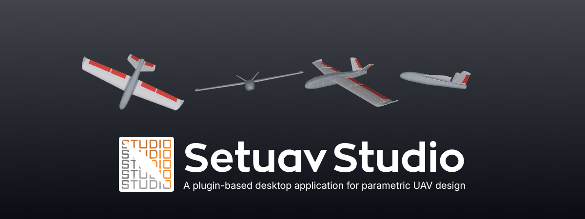
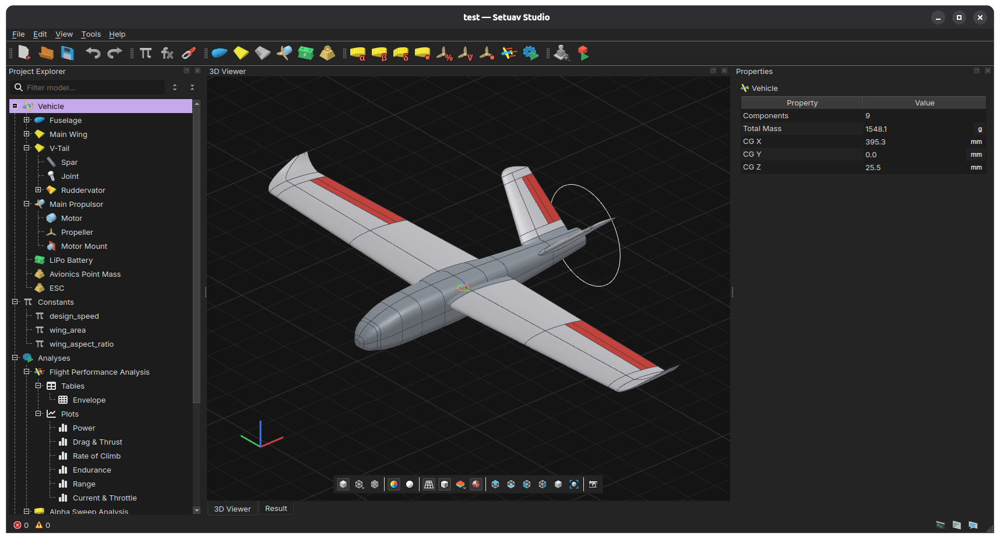
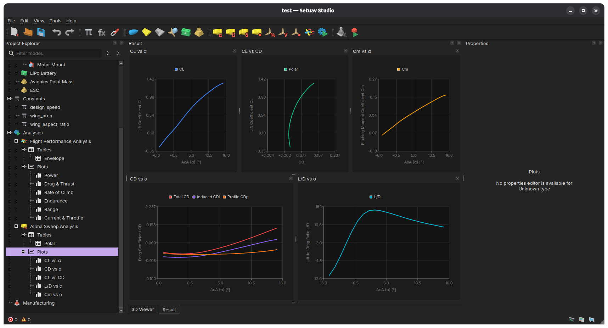
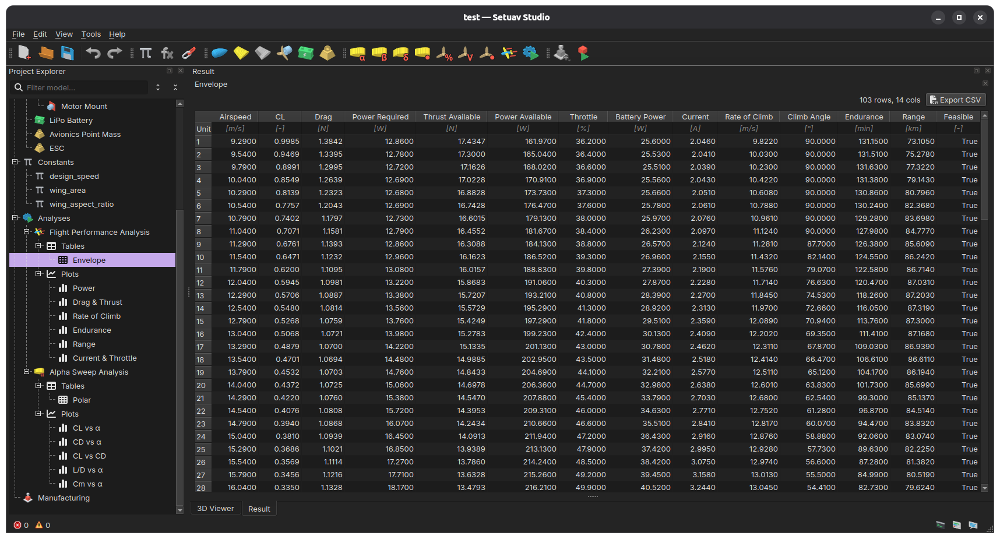

<p align="center">
  
</p>

<p align="center">
  <a href="https://github.com/Setuav/Studio/actions/workflows/ci.yml">
    
  </a>
  <a href="https://github.com/Setuav/Studio/actions/workflows/dependency-audit.yml">
    
  </a>
  <a href="https://setuav.github.io/Studio/">
    
  </a>
  <a href="https://github.com/Setuav/Studio/releases">
    
  </a>
  <a href="LICENSE">
    
  </a>
  
</p>

**Setuav Studio** brings geometry design, engineering analysis, and project data into
one desktop application. It is built with Python and PySide6 and uses a plugin
architecture so design and analysis capabilities can evolve independently.

<p align="center">
  
</p>

<table>
  <tr>
    <td align="center"></td>
    <td align="center"></td>
  </tr>
  <tr>
    <td align="center"><em>Aerodynamic polar plots</em></td>
    <td align="center"><em>Flight performance envelope</em></td>
  </tr>
</table>

## Features

- Parametric fuselage, lifting-surface, and control-surface design.
- Constants, formulas, and constraints that drive any numeric field.
- Interactive OpenGL 3D viewer with selection, section editing, display modes,
  and a center of gravity marker.
- Aerodynamic analyses: alpha sweep, beta sweep, control deflection, and
  operating point, plus single-airfoil analysis.
- Electrical propulsion with a motor, propeller, and battery catalog: throttle
  sweep, airspeed sweep, and operating point analyses.
- Flight-performance envelope: power, climb, endurance, and range.
- Mass and center of gravity from component masses and point masses.
- Results as tables with CSV export and plots.
- Plugin API for panels, toolbar items, tools, component types, editors,
  solvers, and project-tree nodes.
- Folder, `project.json`, and portable `.suav` project support.

## Quick start

Requires Python 3.12 or newer, [`uv`](https://docs.astral.sh/uv/) for locked
dependency management, and a desktop environment supported by PySide6. The
aerodynamics extra installs AeroSandbox; these dependencies are
included by `--all-extras` in the commands below.

Clone the repository and install the locked runtime environment:

```bash
git clone https://github.com/Setuav/Studio.git
cd Studio
uv sync --locked --all-extras
```

Start the application:

```bash
uv run --locked setuav-studio
```

Open an existing project directly:

```bash
uv run --locked setuav-studio path/to/project
uv run --locked setuav-studio path/to/project.suav
```

## Documentation

- [User guide](docs/index.md)
- [Developer documentation](docs/developer/index.md)

## Development

Install the development dependencies:

```bash
uv sync --locked --all-extras --group dev
```

Run the code checks and test suite:

```bash
uv run --locked ruff check .
uv run --locked ruff format --check .
uv run --locked pyright
uv run --locked pytest
```

Tests can also be run for a single area while developing:

```bash
uv run --locked pytest tests/core/
uv run --locked pytest tests/geometry/
uv run --locked pytest tests/aerodynamics/
```

## Desktop build

Create a local PyInstaller build:

```bash
uv sync --locked --all-extras --group desktop
uv run --locked --all-extras --group desktop \
  pyinstaller --noconfirm --clean packaging/setuav-studio.spec
```

The application is created under `dist/setuav-studio/`. CI runs the full package,
startup, security, and dependency checks automatically.

## Plugin development

Plugins extend Setuav Studio through the `StudioAPI`. A plugin can register
panels, toolbar items, tools, settings pages, component types and editors,
solvers, and project-tree nodes. Each plugin owns its activation and
cleanup lifecycle, allowing capabilities to be added without changing the
application core.

At runtime, use **Tools → Plugin Manager** to review active plugins and any
discovery or activation issues. User plugins can be enabled or disabled from
the same screen; the core plugin remains protected.

With MkDocs installed, generate the documentation site:

```bash
uv run --group docs mkdocs build
```

Open `build/docs/site/index.html` in a browser to view the site.

## License

Setuav Studio is released under the [MIT License](LICENSE).
