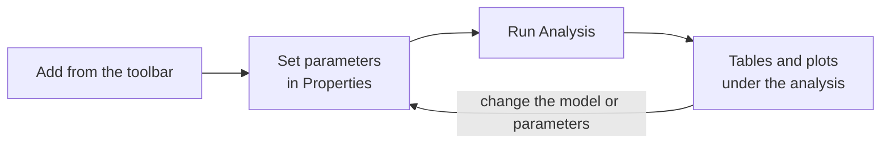
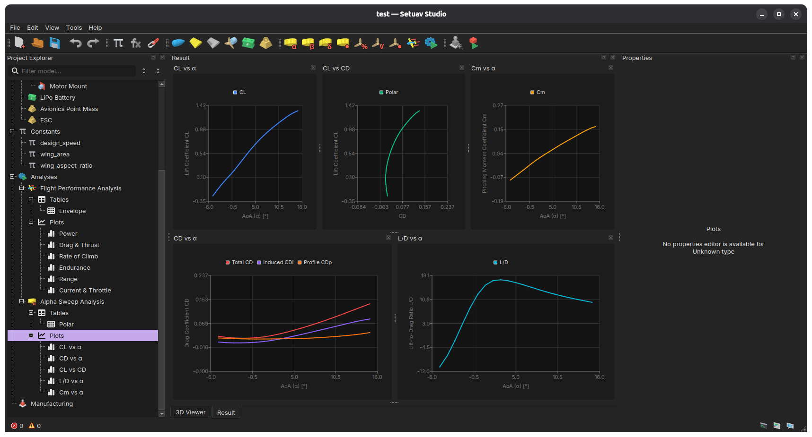
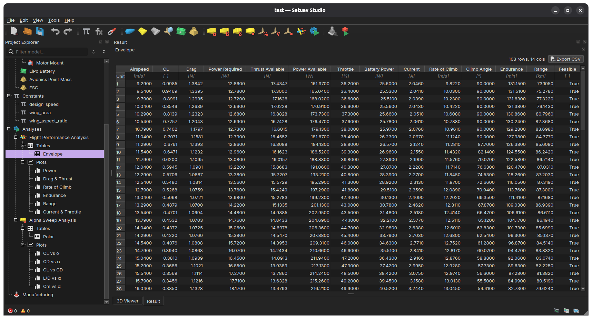

# Analyses

An analysis is a set of parameters saved in the project, together with the
results of its runs. Every analysis works the same way, whichever plugin
provides it.

## Available analyses

| Group | Analysis | Computes |
|---|---|---|
| [Aerodynamics](aerodynamics.md) | Alpha Sweep | Lift, drag and pitching moment over an angle-of-attack range, and the static margin. |
| | Beta Sweep | Side force, rolling and yawing moments over a sideslip range. |
| | Control Deflection | Forces and moments over a control channel's deflection range. |
| | Operating Point | All coefficients and stability derivatives at one flight condition. |
| [Propulsion](propulsion.md) | Throttle Sweep | Thrust, current, power and efficiencies over the throttle range. |
| | Airspeed Sweep | The same quantities over an airspeed range at one throttle. |
| | Operating Point | The powertrain at one throttle and airspeed. |
| [Flight Performance](flight-performance.md) | Flight Performance | The level-flight envelope: power, climb, endurance and range. |

Two tools work outside the project's analyses: **Tools → Aerodynamics →
Airfoil Analysis** analyzes a single airfoil, and **Tools → Electrical
Propulsion → Component Database** browses the motor and propeller catalog.

## Add and run an analysis

1. Click an analysis button in the **Analysis** group of the toolbar. The
   analysis appears under **Analyses** in the Project Explorer, numbered when
   the name is taken, and becomes the current analysis.
2. Set its parameters in the Properties panel. Like other numeric fields they
   accept formulas; see [Parametric Model](../user-guide/parametric-model.md).
3. Click **Run Analysis** in the toolbar, or right-click the analysis and
   choose **Run Analysis**. The toolbar button runs the current analysis.

The status bar reports the start, the end and any error. The Task Manager
(**Ctrl+T**) lists running analyses and can cancel them.

!!! note
    An analysis evaluates the model as it is when it starts. After you change
    the aircraft, run the analysis again to update its results.

## Results

A finished run adds **Tables** and **Plots** under the analysis. Results are
saved with the project.

- **Tables** list every computed point with its unit. **Export CSV** saves a
  table.
- **Plots** draw columns of a table. Right-click **Plots** or **Tables** for
  **Open All Plots**, **Add to View**, which adds a plot to the Result area's
  grid, and **Add Plot…**, which builds a plot from any columns of the table.
- The **Results Summary**, shown in the Properties panel when you select the
  analysis, lists the key values of the run, such as the maximum lift
  coefficient or the maximum range.

!!! warning "Notes in the summary"
    A summary may end with one or more **Note** rows. They name a limit of the
    run that affects its accuracy, for example a mirrored surface the
    aerodynamic model had to split. Read them before you use the numbers.

Values with a physical quantity follow the display units chosen in **Edit →
Settings → Units**.
