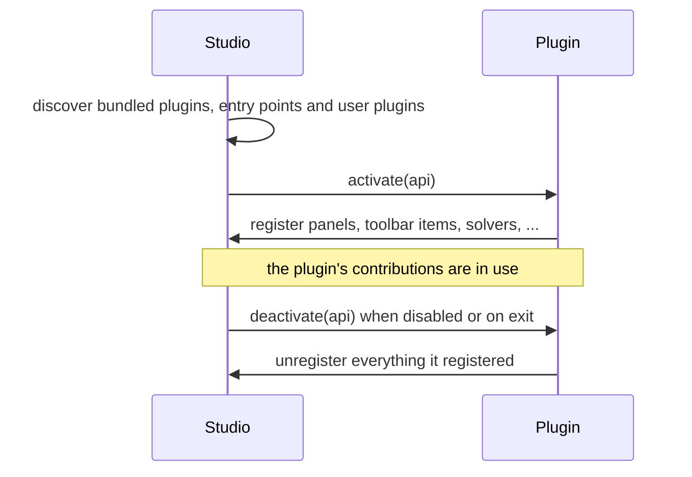

# Developer Guide

Plugins are Python packages that extend Setuav Studio. A plugin can add
panels, toolbar items, menu commands, settings pages, component types and
their editors, analyses, and nodes in the Project Explorer. The bundled
plugins in `src/plugins/` use the same interface;
`src/plugins/flight_performance/` is the smallest of them.

- [Writing a Plugin](writing-a-plugin.md) builds a complete plugin that adds
  an analysis.
- [API Reference](api.md) lists what `StudioAPI` offers.

## Plugin lifecycle

A plugin is an object with an `id`, an `activate(api)` and a
`deactivate(api)` method. Studio activates it at startup; it registers its
contributions through the `StudioAPI` it receives, and undoes each of them
when it is deactivated.



## Discovery and loading

### Installed packages

Declare the entry point in the package's `pyproject.toml`:

```toml
[project]
name = "acme-uav-tools"
dependencies = ["setuav-studio"]

[project.entry-points."setuav_studio.plugins"]
"com.acme.uav-tools" = "acme_uav_tools.plugin:AcmePlugin"
```

The target may be a plugin class or instance with:

- `id`: stable reverse-domain identifier.
- `requires`: optional tuple of plugin IDs that must be active before this plugin activates.
- `activate(api)` and `deactivate(api)`.

### User plugin folder

Plugins can also be placed in the user plugin folder, either as a single
`.py` file or as a folder with a `pyproject.toml` entry point, a package
`__init__.py`, or a `plugin.py`. The folder is set by the
`SETUAV_STUDIO_PLUGINS_DIR` environment variable, otherwise it is the
application data folder's `plugins` directory. The Plugin Manager can install
a plugin archive into it.

### Startup and activation

On startup the host collects the bundled plugins, installed entry points, and
user plugins, orders them topologically by `requires` (alphabetical by `id`
when independent), and calls `activate(api)`.
Contributions become available only after activation returns. Remove all of
them in `deactivate(api)` so the plugin can be disabled and re-enabled safely
from the Plugin Manager.

### Project requirements

A plugin that stores data in projects can declare
`provides = {"com.acme.uav-tools": "1.2.0"}`. A project lists the plugins it
needs under `plugins` as `{"id": ..., "version": ...}`; a missing or
incompatible plugin is reported as a project issue, and the project still
opens.

### Failure scenarios

- An import or entry-point error is logged and the plugin is skipped.
- An exception from `activate` is isolated; other plugins still start.
- A duplicate plugin ID is ignored after the first successful activation.

The host records these failures as load issues shown in the Plugin Manager.
Plugins should check their optional dependencies before registering UI and
report actionable errors with `api.show_status`.

## Testing a plugin

Verify that the plugin can be activated, deactivated, and activated again.
Every registration made in `activate` needs a matching cleanup in
`deactivate`: panels, toolbar items, actions, settings pages, component
types, editors, solvers, icons, providers, and listeners.

## Security

!!! danger "Plugins are not sandboxed"
    Plugins run inside the Setuav Studio process with the application's file,
    network, and operating-system permissions. Install them only from
    publishers you trust.
