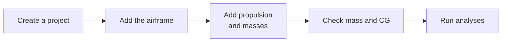

# First Design

This walk-through builds a small fixed-wing aircraft and analyzes it. Each
step links to the page that describes its values in full.

## 1. Create a project

Choose **File → New Project** and pick where to save the `.suav` file. The
Project Explorer shows an empty **Vehicle**.

## 2. Add the airframe

In the **Model** group of the toolbar:

1. Click **Add Fuselage**. It starts with three circular sections.
2. Click **Add Lifting Surface**. The wing attaches to the fuselage with its
   root leading edge at the fuselage origin. Move it aft with **Position X** in
   its **Transform** tab.
3. With the wing selected, click **Add Control Surface** to cut an aileron
   into it.

Every part starts from a default shape. Select it in the Project Explorer or
the 3D Viewer and change it in the Properties panel; see
[Fuselage](../modeling/fuselage.md), [Lifting Surface](../modeling/lifting-surface.md),
and [Control Surface](../modeling/control-surface.md).

!!! tip
    Add a second lifting surface for the tail and rotate it with **Rotation X**
    to build a fin or a V-tail. Positions and rotations are described in
    [Placement and Attachment](../modeling/placement.md).

## 3. Add propulsion and masses

1. Click **Add Propulsor**, then pick a motor and a propeller with **Choose …
   from Catalog…** on its Motor and Propeller pages.
2. Click **Add Battery** and set its cells.
3. Click **Add Point Mass** for items without geometry, such as the receiver
   or a camera, and place them with their **Transform** tab.

See [Propulsion Components](../modeling/propulsion-components.md) and
[Mass and Balance](../modeling/mass-balance.md).

## 4. Check mass and CG

Select **Vehicle** to see the total mass and the center of gravity. The CG
button in the 3D Viewer shows it in the model.

## 5. Run analyses

Add an analysis from the **Analysis** group of the toolbar, set its parameters,
and click **Run Analysis**. Its tables and plots appear under it in the Project
Explorer; see [Analyses](../analyses/index.md).

!!! note
    Use **Edit → Undo** and **Edit → Redo** for any change to the project.
    Save with **File → Save**; see [Project Files](project-files.md).
