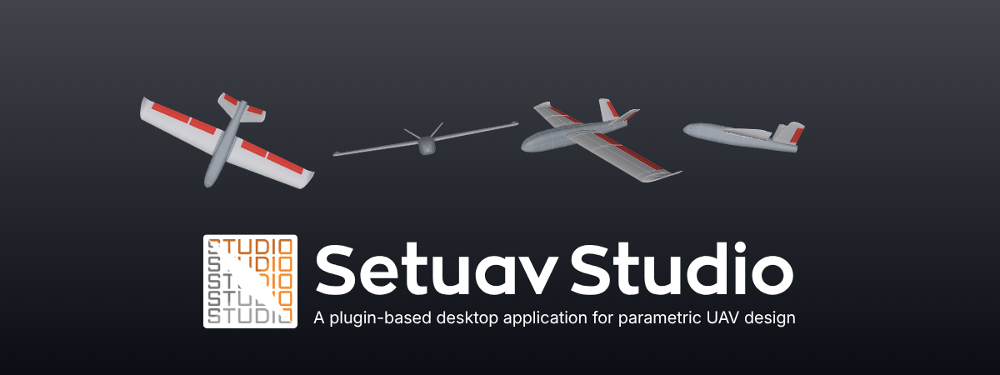
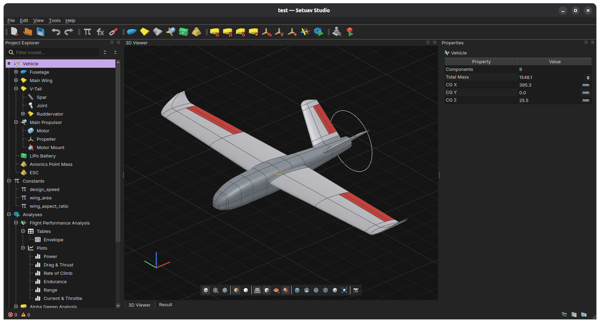

# Setuav Studio

Welcome to the official documentation for **Setuav Studio**, a plugin-based
desktop application for parametric UAV design and analysis.

Setuav Studio brings geometry design, engineering analysis, and project data
into one desktop application. It is built with Python and PySide6 and provides
an extensible plugin API.

## Documentation sections

- [Getting Started](user-guide/getting-started.md) — install the application and
  open your first project.
- [Interface](user-guide/interface.md) — the toolbar, panels, 3D Viewer, and
  analyses.
- [Parametric Model](user-guide/parametric-model.md) — constants, formulas, and
  constraints.
- [Plugin Manager](user-guide/plugins.md) — manage installed plugins.
- Reference — [Geometry](reference/geometry.md),
  [Airfoils](reference/airfoils.md), [Aerodynamics](reference/aerodynamics.md),
  [Propulsion](reference/propulsion.md),
  [Flight Performance](reference/flight-performance.md), and
  [Mass and Balance](reference/mass-balance.md): every parameter, output, and
  equation.
- [Developer Guide](developer/index.md) — build plugins with the Studio API.
