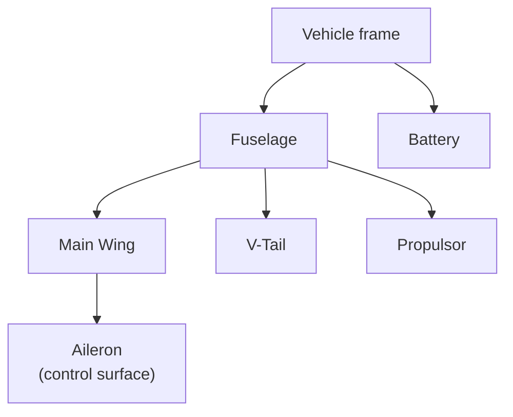

# Placement and Attachment

Every component sits in a frame: the vehicle's, or the frame of the component it is
attached to. This page explains the axes and units, and how parts are placed,
attached, and shown in the Vehicle tree.

## Coordinates and units

All geometry uses one right-handed axis system:

| Axis | Direction |
|---|---|
| +X | Aft, from the nose toward the tail. |
| +Y | Right (starboard), looking forward. A lifting surface is built along +Y. |
| +Z | Up. |

Each component has its own frame. A component that is not attached to another
one is placed in the vehicle frame. The fuselage created by **Add Fuselage** has
its nose at X = 0.

The project stores lengths in millimeters, angles in degrees, and areas in
square decimeters. The Properties panel shows values in the units chosen under
**Edit → Settings → Units**. The default preset, **Metric (SI Standard)**, uses
mm, dm², and degrees.

## Placing and attaching parts

Select a component and open its **Transform** tab.

| Parameter | Unit | Description |
|---|---|---|
| Attached to | — | **Vehicle**, or the component whose frame this component is placed in. |
| Position X, Y, Z | mm | Origin of the component in the frame it is attached to. |
| Rotation X | ° | Roll, about the X axis. |
| Rotation Y | ° | Pitch, about the Y axis. A positive value raises the nose or the leading edge. |
| Rotation Z | ° | Yaw, about the Z axis. |

The rotations are applied in the order yaw, pitch, roll: \(R = R_z R_y R_x\).
Use Rotation Y to set the incidence of a wing. Rotation X = 90° turns the +Y
span of a lifting surface to +Z, for example for a vertical fin.

The origin of each component is:

- **Fuselage**: the point its section positions are measured from.
- **Lifting surface**: the leading edge of the root profile.
- **Control surface**: placed by its lifting surface. Its Transform tab shows
  **Attached to** but does not let you change it there.

### Attachment

A component that is attached to another one moves and rotates with it. A
typical aircraft attaches its parts to the fuselage:

 To
change the attachment, pick another entry in **Attached to**. The list leaves
out the component itself, the components attached to it, and control surfaces.
The component keeps its place in the 3D Viewer; Studio recalculates its
Position and Rotation in the new frame.

- **Add Lifting Surface** attaches the new surface to the first fuselage in the
  project, if there is one.
- A control surface is always attached to a lifting surface. Choose the surface
  under **Lifting Surface** in the control surface's **General** section.
- A mirrored lifting surface is mirrored across the XZ plane of the component
  it is attached to.
- When a lifting surface is attached to a fuselage and its root does not reach
  the fuselage surface, the 3D Viewer fills the gap between the root and the
  fuselage.

### Vehicle tree

In the Project Explorer, fuselages and lifting surfaces are listed directly
under **Vehicle**, whatever they are attached to. Control surfaces are listed
under their lifting surface. Deleting a lifting surface also deletes its control
surfaces. Components attached to a deleted component are attached to the
vehicle where they are.
