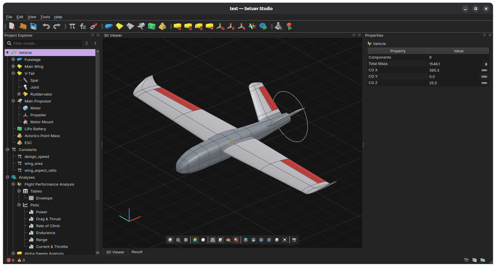
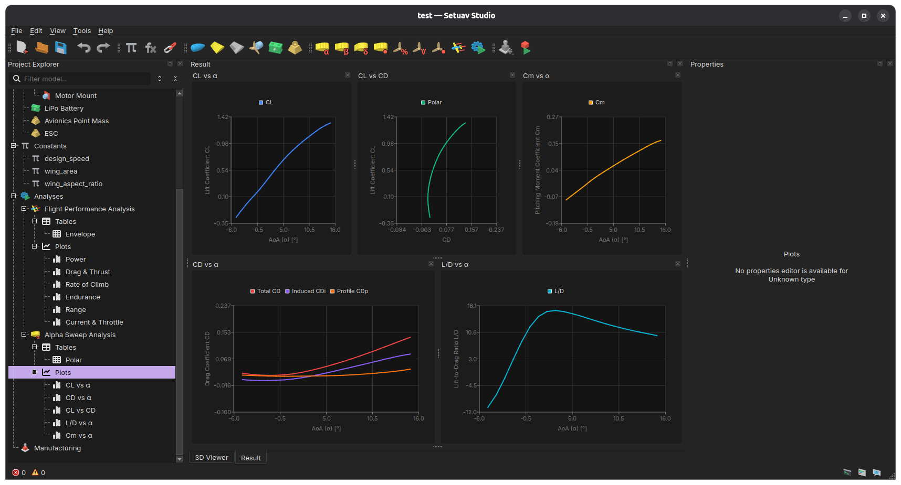
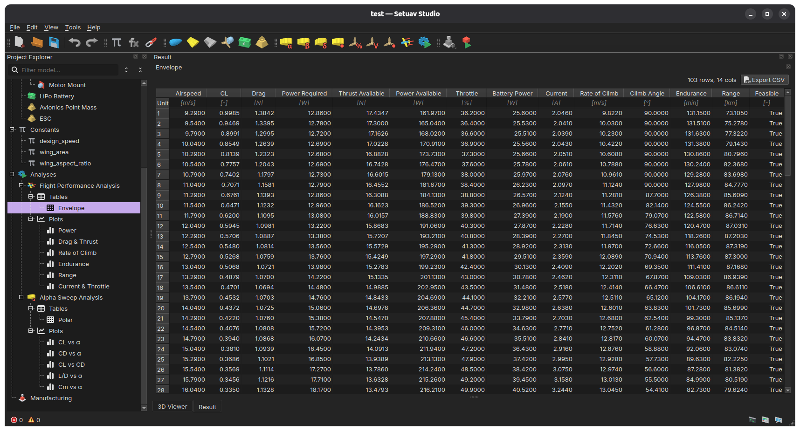

# Interface

Setuav Studio uses a single window. The toolbar adds model parts and
analyses, the Project Explorer lists everything in the project, the Properties
panel edits the selected item, and the center area shows the 3D Viewer or an
analysis result.

## Toolbar

The toolbar is grouped from left to right:

- **File** — New Project, Open Project, and Save.
- **Edit** — Undo and Redo.
- **Parameters** — Add Constant, Formula Assistant, and Add Constraint.
- **Model** — Add Fuselage, Lifting Surface, Control Surface, Propulsor,
  Battery, and Point Mass. New parts start from a default shape; change it in
  the Properties panel.
- **Analysis** — one button per analysis type, followed by **Run Analysis**.

## Project Explorer

The tree holds these groups:

- **Vehicle** — the components of the aircraft. Control surfaces appear under
  their lifting surface, and the motor and propeller under their propulsor.
- **Constants** — named values that fields and formulas can reference.
  Constraints, when the project has any, are listed in their own group.
- **Analyses** — each analysis with its **Tables** and **Plots** after it runs.

Use the filter box to find an item by name, and the buttons beside it to expand
or collapse the whole tree. Right-click an item to rename, delete, or run it.

## Properties

The Properties panel edits the item selected in the tree or in the 3D Viewer.
Numeric fields accept a number or a formula that uses the project constants;
see [Parametric Model](parametric-model.md).
Components with several groups of settings show them in tabs or sections.

Selecting **Vehicle** shows the component count, total mass, and center of
gravity.

## 3D Viewer

Drag with the left button to orbit, the middle button to pan, and the right
button or the scroll wheel to zoom. Click a part to select it. The bar at the
bottom of the viewer switches between solid, wireframe, and transparent
display, colored or monochrome parts, the reference grid, the center of
gravity marker, the camera views, and fit to view (**F**). The last button
saves a screenshot.

## Analyses

1. Add an analysis from the toolbar. It appears under **Analyses**.
2. Select it and set its parameters in the Properties panel.
3. Click **Run Analysis**. The Task Manager (**Ctrl+T**) shows running work.
4. Open its tables and plots in the Result area.

Plots of one analysis are arranged side by side:

Tables list every computed point with its unit, and **Export CSV** saves them:

Available analyses:

| Group | Analyses |
|---|---|
| Aerodynamics | Alpha Sweep, Beta Sweep, Control Deflection, Operating Point |
| Propulsion | Throttle Sweep, Airspeed Sweep, Operating Point |
| Performance | Flight Performance |

**Tools → Aerodynamics → Airfoil Analysis** analyzes a single airfoil, and
**Tools → Electrical Propulsion → Component Database** browses the motor and
propeller catalog.

## Settings and shortcuts

**Edit → Settings** holds the general, appearance, and unit settings and the
pages that plugins add. The theme can also be changed from **View → Theme**.

| Shortcut | Action |
|---|---|
| Ctrl+Shift+P or F1 | Command Palette |
| Ctrl+T | Task Manager |
| Ctrl+P | Plugin Manager |
| Ctrl+Z / Ctrl+Shift+Z | Undo / Redo |
| F | Fit model in view |
